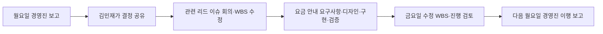

# 대기업 주간 업무 운영 — 합의 반영·구현 보고

작성일: 2026-10-14 · 대상: ConflictDynamics 팀원 · 기준 커밋: `47167de` 위에 추가

## 무엇을 바꿨나

기존의 ‘짧은 일을 하루에 끝내는 회사’와 별도로, **대기업 일부 직원 10명이 여러 날에 걸쳐 일하고 검토·보고하는 주간 시나리오**를 추가했다. 사용자와 합의한 업무 경험을 반영했다. 기존 `r10_midweek`와 연구 시나리오의 설정은 유지한다.

첫 월요일부터 금요일, 다음 월요일까지 **6근무일**을 관찰한다. 금요일 주간회의 결과가 다음 월요일 경영진 보고로 이어지는지 보려는 구현 선택이다. 경영진은 새 에이전트로 추가하지 않는다.

## 합의한 운영 방식

| 영역 | 반영한 기준 |
| --- | --- |
| 근무·점심 | 09–18시, 점심 13–14시. 기본 시간 단위 15분. |
| 일일 회의 | 스탠드업 20분과 대기·이동·짧은 잡담 10분을 합쳐 30분 예약. |
| 금요일 | 김민재·4개 팀 리드의 주간회의 60분. 안건 담당 실무자가 발제한다. 단순 보고보다 방향과 주요 결정 검토가 중심이다. |
| 월요일 | 김민재의 외부 경영진 회의 60분, 앞뒤 이동과 대기, 돌아온 뒤 관련 리드 공유 30분. |
| 김민재 | 배정, 판단·결재, 중요 문서 검토, 도움, 대외 대표와 공지. |
| 팀 리드 | 검토·문제 해결·지원과 WBS·일정·배정·조율을 대략 5:5로 수행한다. 개발 업무 50%를 뜻하지 않는다. |
| 실무자 | 실행이 중심이고 회의·연락·지원이 약 20%다. 비율을 강제하지 않는다. |
| 업무 진행 | 장시간 작업과 다음 날 이어지는 업무를 허용한다. 선행 업무 승인 후 다음 단계에 착수하고 중간·최종 보고와 검토를 한다. |
| 회의록 | 회의마다 한 명만 담당한다. 주간·스탠드업·경영진·이슈 회의 기록을 각각 하나씩 둔다. |
| 대기 | 다른 자기 업무나 자료·코드 정리, 회의·발표 준비를 한다. 준비와 회의 이동은 휴식이 아니다. |
| 도움 | 팀 내 도움은 쉽게, 다른 팀은 전문성과 업무 맥락이 맞을 때만 한다. 정식 협업은 양측 리드 합의, 긴급 도움은 사전·사후 보고가 기준이다. |
| 연락 | 반 근무일 기다린 뒤 한 번 리마인드, 다시 반 근무일 뒤에도 답이 없으면 자기 리드를 통해 상대 리드에게 확인한다. 점심·퇴근 후 시간은 제외한다. |
| 휴식 | 스트레스나 여유에 따라 자율적으로 선택한다. 팀·직급에 관계없이 동시에 최대 3명. 일일 휴식량을 강제하지 않는다. |

경영진 보고 준비는 수합·검토 90분과 정리·발표 준비 60분으로 설정했다. 90분은 여러 날에 나누며, 60분 중 마지막 30분에 마무리한다. 첫 월요일 이전에는 120분 준비가 진행된 상태로 시작한다. 이는 관찰 시작점을 위한 가정이다.

## 바빠지는 구간

경영진 방향 변경은 **상세 분석을 다음 버전으로 미루고 요금 안내를 우선 완성하는 것**이다.



상세 분석의 작업 기록은 삭제하거나 완료 처리하지 않는다. 다음 버전으로 보류하고 이번 주 활성 업무에서 제외한다. 요금 안내는 WBS와 요구사항·디자인·구현·검증 승인 순서에 따라 진행한다. 실패 원인·검증 결과 분석에는 별도로 60분의 작업량을 배정했다.

## 코드가 보장하는 것과 에이전트가 판단하는 것

**엔진이 강제하는 규칙**

- 09–18시와 13시 점심, 고정 회의·준비·외부 보고·이동 시간의 예약.
- 예약된 시간에는 별도 업무 판단을 하지 않는다. 외부 회의 중인 김민재에게 즉석 대화를 걸 수 없다.
- 실제 승인 단계와 업무 의존성, 여러 날 이어지는 작업 상태 보존.
- 동시에 최대 3명의 휴식. 준비·회의·이동은 휴식 집계와 회복에서 제외한다.
- 막힌 업무의 진행 확인에 대해 근무시간 기준 4시간 대기, 한 번 리마인드, 8시간 후 리드 간 확인. 다음 날에도 상태를 유지한다.
- 다른 팀 도움에 최소한 해당 작업과 맞는 기술이 있어야 한다.
- 상세 분석 보류, 지정한 요금 안내 업무 마감 조정, 변경 내용 전달.
- 캘린더의 중복 예약·잘못된 담당자·점심 중 회의를 실행 전에 거부한다.

**업무 지침으로 제공하고 판단을 남겨둔 부분**

- 리드 5:5·실무자 8:2 비중, 중요 업무에 리드가 얼마나 참여할지.
- 실제 산출물을 읽고 정확성과 형식을 판단하는 품질.
- 정식 협업의 양측 동의와 긴급 도움의 사전·사후 보고. 별도 동의 상태 기계는 만들지 않았다.
- 여유와 스트레스에 따른 휴식 선택, 동료를 따라 쉬는 선택.
- 다른 일이나 준비 중 무엇을 할지와 업무 중간 보고의 내용.

따라서 **규칙 구현 완료와 실제 회사처럼 행동한다는 검증은 구분한다.** 이번 무료 데모는 전자를 확인한다.

## 구현 선택·제한

- 새로운 시나리오 이름은 `r10_enterprise_weekly`다. 기존 10명·4개 기능 팀을 유지한다.
- 주간회의는 금요일 15–16시, 경영진 회의는 월요일 11:15–12:15로 배치했다. 정확한 시각과 발제자 이도윤은 구현 가정이다.
- 월요일 방향 변경에 따른 이슈 회의는 14:15–14:45다. 임의의 이슈에 대해 자동으로 빈 시간을 찾는 일반 일정 관리기는 구현하지 않았다.
- 스탠드업의 20분 발언과 10분 이동을 엔진 내부에서 초 단위로 나누지는 않는다. 합계 30분을 예약하고 회의 기록에 구분을 남긴다.
- 작업 시간은 15분 단위 **작업량 추정치**다. 스트레스에 따른 속도나 도움을 주는 인원에 따라 실제 경과 시간은 달라진다.
- 근무 종료 뒤 30분의 야근 구간을 열어 두었지만 모든 직원의 야근을 강제하지 않는다. 회의록은 전용 업무로 남아 다음 날 이어질 수 있다. 마감 당일 반드시 완료시키는 강제 행동은 넣지 않았다.
- 진행 확인은 ‘내 업무를 막는 선행 업무 담당자에게 보내는 메시지’가 대상이다. 같은 상대의 답장이 오면 응답으로 처리한다. 답장의 실질적 충분성은 별도 의미 분석하지 않는다.
- 담당 업무와 자료는 연구용 시나리오다. 실제 PwC 업무나 내부 문서를 복제한 것이 아니다. 요금 안내의 세부 내용·마감·작업량은 도메인 검토가 필요하다.

## 무료 검증 결과

- 유료 OpenAI API 사용 없음. `DemoBackend`만 사용했다.
- 10명 × 6근무일 × 하루 38틱(정규 36 + 야근 가능 2) = **228틱**, **50개 업무**, **26개 대화 세션**.
- 스탠드업 6회, 금요일 주간회의 1회, 방향 변경 이슈 회의 1회가 예정 참가자·시작·종료 시각에 맞게 실행됐다.
- 월요일 외부 경영진 보고 2회의 60분 예약을 확인했다.
- 회의록 10개가 각각 한 명에게 배정됐고, 데모 종료 시 모두 완료됐다.
- 실제 승인된 행동 기록에서 동시 휴식 최대 **3명**을 확인했다.
- 상세 분석은 삭제 없이 보류됐다. 자동 검사 9개가 통과했다.
- 기존 테스트와 신규 테스트를 포함한 회귀 검사: **588 passed, 1 skipped**. Ruff 검사 통과.

데모에는 **617회의 거부된 행동**이 있었다. 대부분 여러 직원이 같은 순간 휴식을 선택하여 상한에 걸린 경우다. 무료 규칙 기반 데모는 같은 계획을 반복하는 성질이 있어 이 숫자를 직원의 갈등 빈도나 실제 LLM의 토큰 비용으로 해석하면 안 된다. 새 규칙의 작동은 확인했지만 자연스러운 업무 분배·혼잡도·휴식 선택은 아직 검증되지 않았다.

## 중간 산출물과 재현

1. **YAML** — `conf/scenario/company_c15/r10_enterprise_weekly.yaml`: 업무, 담당자, 마감, 일정과 지침. 도메인 의견을 코드와 분리해 검토하기 좋다.
2. **Markdown** — 이 문서: 합의·구현·가정·검증을 팀원이 쉽게 읽는 기록.
3. **JSON** — `docs/research/enterprise_weekly_validation_2026-10-14.json`: 검사 결과와 결과 해시. 이후 버전 비교에 사용한다.

```bash
.venv/bin/python scripts/weekly_operations_validation.py --output runs/domain-week-preview
```

위 명령은 유료 API 경로 없이 데모를 실행하고 `weekly_validation.json`을 만든다. 출력 폴더는 새 경로여야 한다. 기존 뷰어의 `frames.jsonl`, `inspect.jsonl`, 업무·대화·기억 기록도 생성된다. 전체 실행 자료는 Git에서 제외되는 `runs/`에 있고 핵심 검증 JSON만 공유한다.

## 다음 검토

먼저 무료 리플레이에서 **각 직원이 실제 맡은 일, 김민재·리드의 시간 사용, 바쁜 구간의 강도, 회의록·검토 누락 여부**를 도메인 담당자가 확인하는 것을 권한다. 세부 업무량과 일정은 YAML에서 조정한다. 정식 협업 승인 절차와 일반적인 이슈 회의 자동 배치는 필요성이 확인되면 별도 구현한다.

실제 API 실행은 아직 **HOLD**다. 이번 데모의 완료를 실제 LLM 행동 검증이나 토큰 절감 증거로 사용하지 않는다. 토큰 효율화 캐시와 H1/H2, 개입 효과 연구 실험은 이번 변경에 추가하지 않았다.
